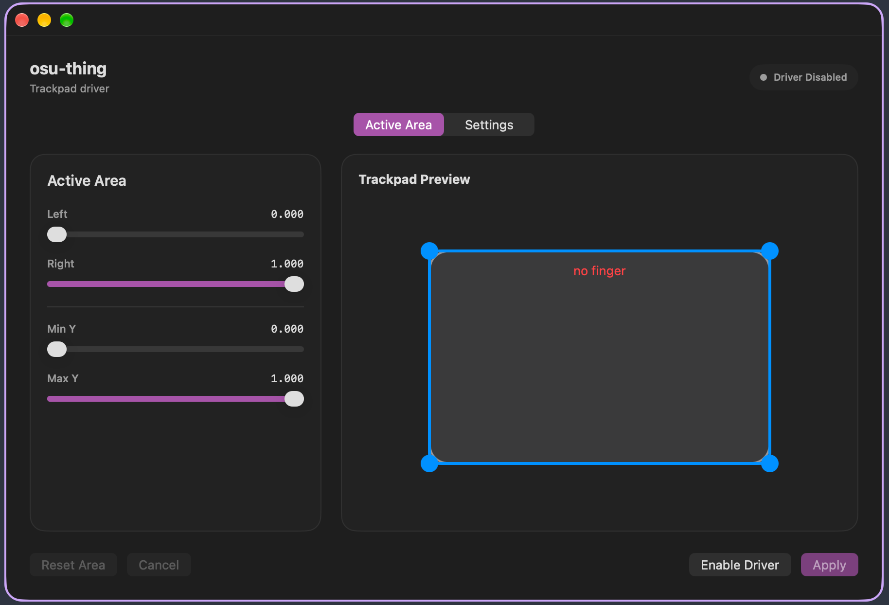

<p align="center">
  
  
</p>

<p align="center">An app that allows your trackpad to have <b>absolute positioning</b> for playing osu!</p>

<hr>



## Features 

- A `.config` file so you can transfer your settings from one machine to another easily.
- Automatically detect and enable the driver when playing a beatmap
- Aspect Ratio Fixer so if you use a external monitor your trackpad will scale accordingly 

## Installation

> [!NOTE]
> **Private Framework:** osu-thing uses Apple's private
> `MultitouchSupport.framework` to access raw trackpad input.
> This framework is not a public API and may change or stop working
> in previous or future macOS versions.
>
> osu-thing currently targets **macOS 27.0**.
 
### Using homebrew

``` bash
brew tap yahddyyp/tap
brew install --cask osu-thing
```

## Usage 

1. Just open the app (and give it the required permissions) and select your trackpad area you would like to use
2. Press apply and you are done 
3. To disable the driver just press disable driver in the app or `F8` on your keyboard

## Special Thanks

- [@tradicije](https://github.com/tradicije) - for designing the app icon and banner
- [@MEMORIEmusic](https://github.com/MEMORIEmusic) - for designing the initial ui designs

## Inspiration 

- https://github.com/EricPanDev/Mac-Trackpad-OSU-Tablet

## License

[GPL 3.0 or later](./LICENSE), copyright 2026 Yahddyyp. Project artwork and branding, including the osu-thing name, logo, icons, and visual identity, are covered separately in [TRADEMARKS.md](/TRADEMARKS.md).

This app is made by me, expect bugs
